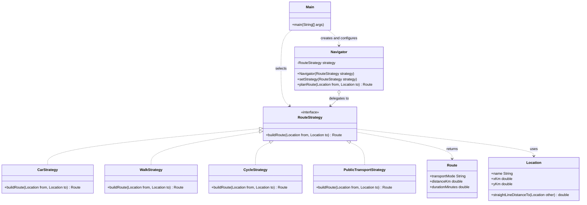

# Assignment 5: Strategy Pattern

Course: ShP-2216 Software Design Patterns. Individual assignment, Option A (Navigation and Route Planning).

## 1. Introduction

The chosen domain is route planning. A user wants to get from one place to another, and the way the route is calculated depends on how they travel. The family of algorithms here is route calculation per mode of transport: by car, on foot, by bicycle and by public transport. Each mode estimates the real distance by multiplying the straight line distance by a winding factor for that kind of road, and estimates the duration from an average speed. Public transport also adds an average waiting time at the stop. The algorithms share one goal and one signature but differ in their numbers and steps, which makes them a natural fit for the Strategy pattern.

The Navigator is the context. It holds a RouteStrategy and delegates planning to it. The user can change the transport mode while the program is running, and the Navigator accepts the new strategy without any change to its own code.

## 2. UML class diagram



Roles: Navigator is the Context, RouteStrategy is the Strategy interface, the four classes that implement it are the Concrete Strategies, and Main is the Client that chooses the strategy and passes it to the context.

## 3. Clean Code

This section covers six principles from Clean Code, Chapter 10 and the related reading.

### 3.1 Polymorphism instead of conditional logic

The first version of the idea, which I did not keep, put every mode in one method and chose the algorithm with a branch on the mode.

Before:

```java
public Route planRoute(Location from, Location to, String mode) {
    double distance = from.straightLineDistanceTo(to);
    if (mode.equals("car")) {
        return new Route("Car", distance * 1.3, distance * 1.3 / 40.0 * 60.0);
    } else if (mode.equals("walk")) {
        return new Route("Walk", distance * 1.1, distance * 1.1 / 5.0 * 60.0);
    } else if (mode.equals("cycle")) {
        return new Route("Cycle", distance * 1.15, distance * 1.15 / 15.0 * 60.0);
    }
    throw new IllegalArgumentException(mode);
}
```

After:

```java
public Route planRoute(Location from, Location to) {
    return strategy.buildRoute(from, to);
}
```

The decision about which algorithm runs is now made once, by the client, when it hands over a strategy object. The Navigator contains no if and no switch.

### 3.2 Meaningful, intention-revealing names

The names say what each thing is for. A strategy is called CarStrategy, not Algorithm1, and the interface method is buildRoute, not execute or calc.

Before:

```java
double calc(Location a, Location b, int t)
```

After:

```java
Route buildRoute(Location from, Location to)
```

The parameters and the return type now explain themselves, so a reader does not need to look up what t or the returned double meant.

### 3.3 Single Responsibility

Each strategy class has one reason to change, which is the way its own mode of transport is calculated. If cycling speed assumptions change, only CycleStrategy is edited. In the before version all modes lived in one method, so a change to walking risked breaking driving.

After, the whole class is this small:

```java
public class WalkStrategy implements RouteStrategy {

    private static final double ROAD_WINDING_FACTOR = 1.1;
    private static final double AVERAGE_SPEED_KMH = 5.0;
    private static final double MINUTES_PER_HOUR = 60.0;

    @Override
    public Route buildRoute(Location from, Location to) {
        double distanceKm = from.straightLineDistanceTo(to) * ROAD_WINDING_FACTOR;
        double durationMinutes = distanceKm / AVERAGE_SPEED_KMH * MINUTES_PER_HOUR;
        return new Route("Walk", distanceKm, durationMinutes);
    }
}
```

### 3.4 The context stays algorithm-agnostic

The Navigator imports only the RouteStrategy interface. It does not import any concrete strategy and does not know how any of them computes a result.

```java
import navigation.strategy.RouteStrategy;

public class Navigator {
    private RouteStrategy strategy;
    ...
}
```

This is what lets the Navigator work with strategies that did not exist when it was written. It also validates the strategy with Objects.requireNonNull, so a missing strategy fails early with a clear message and not later with a confusing NullPointerException.

### 3.5 Easy extensibility (Open/Closed)

Adding public transport required one new class and one line in the client. No existing strategy and not the Navigator was modified, and this is visible in the commit history as two separate commits.

```java
public class PublicTransportStrategy implements RouteStrategy {
    ...
}
```

```java
List<RouteStrategy> availableStrategies = List.of(
        new CarStrategy(),
        new WalkStrategy(),
        new CycleStrategy(),
        new PublicTransportStrategy()
);
```

In the before version, the same feature would have meant opening the large method and adding another branch, which is exactly the kind of edit that introduces bugs in code that already worked.

### 3.6 Named constants instead of magic numbers

Every number that matters is a named constant, so the meaning is visible at the point of use.

Before:

```java
distance * 1.3 / 40.0 * 60.0
```

After:

```java
double distanceKm = from.straightLineDistanceTo(to) * ROAD_WINDING_FACTOR;
double durationMinutes = distanceKm / AVERAGE_SPEED_KMH * MINUTES_PER_HOUR;
```

## 4. Strategy vs. State

The two patterns have almost the same class structure, a context that delegates to an object behind an interface, but they solve different problems. In State, the object changes its own behaviour because its internal condition changes, the states usually know about each other and trigger the transitions themselves, and the client does not choose them. In Strategy, the client chooses the algorithm from outside, the strategies know nothing about each other, and a strategy is never replaced by another strategy on its own. Route planning is Strategy because the transport mode is a decision made by the user, not a lifecycle that the Navigator moves through. CarStrategy does not finish and hand control to WalkStrategy, and the Navigator has no internal condition that would cause such a switch. If the problem were an order that moves from created to paid to shipped, with each step deciding what comes next, State would be the right choice.

## 5. Conclusion

The price of the pattern is a handful of extra files: one interface and four strategy classes, where the naive version had one method. In return, the Navigator has no branching, every algorithm can be read and changed on its own, the transport mode can be switched at runtime with a single setStrategy call, and a new mode costs one class without touching tested code. For a family of only three or four small algorithms the structure is slightly heavier than a plain conditional, but it pays off as soon as a fifth mode, or more complicated logic such as real road graphs or traffic data, is added. The main trade-off is that the client must know which strategies exist so that it can pick one.

AI use statement: ChatGPT and Claude (Anthropic) were used as assistants while preparing the code structure and this report. I reviewed the result, I understand every class, and I will explain and write it myself at the defense.

## 6. GitHub repository

https://github.com/YOUR-USERNAME/route-planner-strategy
